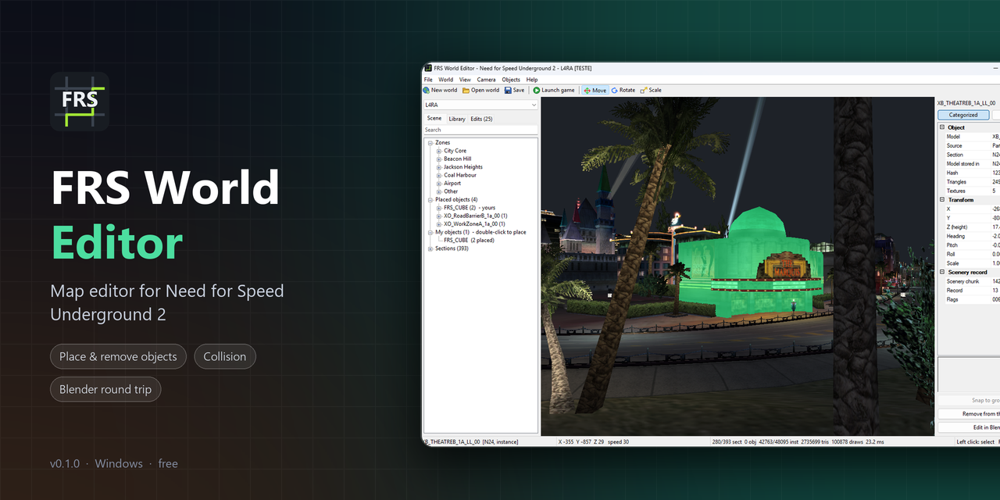

<p align="center"></p>

<p align="center">
  <a href="https://discord.gg/jTKwQXYQkb"></a>
  <a href="../../releases/latest"></a>
</p>

# FRS World Editor

A map editor for **Need for Speed Underground 2**, by Chrystian Farias.

The editor reads the game's own `TRACKS` streams directly -- nothing is
converted or imported first -- so what the viewport draws is what the game
ships. What you change goes to `<game>\models`, never into the game's files,
and a small ASI plugin puts it into the game as it loads.

**[Download the latest release](../../releases/latest)** -- unzip, run
`FRSWorldEditor.exe`, and the setup does the rest.

Questions, bugs, ideas, or something you built: join the **[official Discord](https://discord.gg/jTKwQXYQkb)**.

If the editor helps you, you can [buy me a coffee](https://buymeacoffee.com/chrystianfarias).

## What it does

- **The whole city, as shipped.** Every region, its objects, scenery,
  textures and baked night lighting, with a free-flight camera. Textured,
  unlit, vertex-colour and wireframe views, collision overlay, texture browser.
- **Objects.** Place any model of the region from a catalogue with a picture of
  each, sorted into shelves (buildings, lights, signs, fences, trees, vehicles...),
  then move, rotate, snap to
  the ground, copy and paste, move or remove shipped objects (a moved one is replaced by a placement of the same model). Every
  edit is listed and can be reverted one by one.
- **Meshes and collision.** Export a selection to OBJ, edit it in any 3D
  tool, import it back -- geometry, textures and collision.
- **Collision tools.** The Collision menu draws collision straight onto the
  map: barriers (no height limit), walls with a real height, and ground from
  an outline, each snapping to the corners already there. Selected collision
  can be moved (G), deleted (Del) and given another surface -- road, grass,
  sidewalk, metal... -- in the properties panel; Ctrl+Z undoes. Polygons along
  a section edge are kept by both neighbours, and every edit reaches both.
  Selected objects get collision from their own mesh with one button
  (Make collision in the properties panel, Ctrl+Shift+K): walls round what a
  car can hit and ground on their tops, or just ground for ramps and decks.
- **Mesh editor.** Tab on a selected object edits its shape in place: pick
  vertices, edges or faces (1 / 2 / 3), move, turn or scale them with the gizmo
  and watch the model change; Ctrl+Z steps back and Tab writes it, the same way
  an edit from Blender comes back. Every placement of the model changes.
- **Edit in Blender.** Objects > Edit in Blender (Ctrl+Shift+E) opens the
  selection in Blender; every save there (Ctrl+S) loads it back into the
  editor. Nothing to install in Blender -- the editor brings its own script.
- **New objects.** Model something new in Blender (Objects > New Object in
  Blender, Ctrl+Shift+N, opens an empty scene centred on the view) or bring any
  OBJ in (Objects > New Object from OBJ). Each shape becomes a model of its own,
  placed where it stands, with its textures or plain material colours.
  They are listed as yours in Objects > Place My Object (Ctrl+Shift+P), to
  place again anywhere; editing one in Blender updates every copy.
- **Zones and quick travel.** The city's named zones (Pigeon Park, Coal
  Harbour East, Jackson Heights...) grouped by district in the Scene tab and in
  Camera > Travel To; the camera flies there, and the status bar names the zone
  it is over.
- **Launch game.** Starts the game straight into free roam, with your car on
  the street where the editor's camera is -- inside the editor's window when
  the game runs windowed.

## Getting started

1. Download the release zip and unzip it anywhere.
2. Run `FRSWorldEditor.exe`. The first time, the setup:
   - finds the game (registry, usual folders) or lets you pick the folder with
     `SPEED2.EXE`;
   - installs the game-side plugins: Ultimate ASI Loader (`dinput8.dll`,
     skipped if the game already has an ASI loader), `FRSWorldLoader.asi` and
     `FRSFastTest.asi` (it replaces the older `FRSFastBoot.asi`, which is moved
     aside: the two together crash the game as it starts);
   - asks for administrator rights once if the game is under Program Files.
3. Pick a region at the top left. Right mouse to look, `W` `A` `S` `D` to
   move, `Q` / `E` down / up, Shift faster, Ctrl slower.

Run the setup again from **File > Game Folder and Plugins**.

The plugins are written for `SPEED2.EXE` v1.2 (MD5
`6445adbf4e8d64be51e96a69bba168a4`). The editor opens any version's files; on
another executable the plugins leave the game alone.

### Keys

| Input | Action |
| --- | --- |
| Right mouse | Look around |
| `W` `A` `S` `D`, `Q` / `E` | Move, down / up |
| Shift / Ctrl | Faster / slower |
| Wheel | Base movement speed |
| Left click, Ctrl+click | Select, add to the selection |
| `G` / `R` | Move / rotate the selection |
| `1` `2` `3` | Gizmo: move, rotate, scale -- also on the toolbar (drag its handles; Ctrl snaps turns to 15 degrees) |
| Drag from Library | Place a model where you let go, on the ground under the pointer |
| `Home` | Frame the region |
| `F1`-`F4` | Textured, unlit, vertex colours, wireframe |
| `F5` `F6` `F7` | Backdrop, backface culling, scenery |
| `F9` | Texture browser |
| Ctrl+K | Collision overlay |
| Ctrl+Shift+W / H / G | Draw a barrier / a wall with height / ground (Enter or a double click finishes, Esc stops) |
| Ctrl+Shift+K | Make collision for the selected objects |
| Tab | Edit the selected object's mesh; Tab again writes it (1/2/3 vertices/edges/faces, Ctrl+A all) |
| Ctrl+Z | Undo (collision, and objects placed, moved or deleted) |
| Ctrl+N | Place an object |
| Ctrl+E / Ctrl+I | Export selection / import edited OBJ |
| Ctrl+Shift+E | Edit the selection in Blender |
| Ctrl+Shift+N | New object in Blender |
| Ctrl+S | Save the world |
| Ctrl+Shift+S | Write placements and collision edits to the game |

## Building

Visual Studio 2022 with the C++ workload and CMake 3.21 or newer. No other
dependencies: `D3DX` is not part of the modern SDK, so the maths is hand
written.

```
cmake -S . -B build -G "Visual Studio 17 2022" -A x64
cmake --build build --config Release
```

The game is 32-bit, so its plugin is built for Win32:

```
cmake -S loader -B loader/build -G "Visual Studio 17 2022" -A Win32
cmake --build loader/build --config Release
```

`package.ps1` builds everything, FRSFastTest included (from its own
repository, by default `D:\Outros\FRSFastTest`), downloads Ultimate ASI
Loader and writes the release folder and zip to `dist\`.

### Extensions

The editor and the loader can be built with extensions of their own: a folder
with an `editor.cmake` (and a `loader.cmake` for the game side) at `./private`,
or wherever `-DFRS_EXTENSIONS_DIR=` points, is compiled in. The editor's side
implements `src/ui/EditorExtension.h` and `src/render/RenderExtension.h`, the
loader's `InstallExtensions` / `ExtensionsFrame` in `loader/src/Loader.h`.
Without such a folder -- this repository on its own -- the build has none;
`-DFRS_WITH_EXTENSIONS=OFF` leaves them out even when the folder is there.

## Layout

```
src/core      file mapping, maths, logging
src/nfs       the file formats: chunks, section table, geometry, textures,
              scenery, collision, free-roam zones
src/io        reading and writing edits: placements, OBJ, textures
src/render    Direct3D 9 device, GPU buffers, camera, renderer
src/ui        the Win32 frame, viewport, panels and the setup wizard
loader        FRSWorldLoader.asi, the game side
packaging     what goes into the release beside the executable
docs          the file formats, and how they were worked out
tools         Python scripts used to explore and validate the formats
third_party   Dear ImGui (MIT), Phosphor icons (MIT), the Win32 property grid (CPOL)
```

[`docs/NFSU2-FORMATS.md`](docs/NFSU2-FORMATS.md) records the chunk layouts,
field offsets and the rules a parser has to get right, and what the plugin
does inside the game, address by address.

## Credits

Created by **Chrystian Farias**.

- [Dear ImGui](https://github.com/ocornut/imgui) 1.91.9b, docking branch (MIT), in `third_party/imgui`: the panels.
- [Phosphor Icons](https://phosphoricons.com) 2.1.1 (MIT), in `third_party/phosphor`: the icons.
- Win32 property grid by David MacDermot (CPOL), in `third_party/propertygrid`.
- [Ultimate ASI Loader](https://github.com/ThirteenAG/Ultimate-ASI-Loader) by
  ThirteenAG (MIT), shipped in the release package.
- The [NFSU2ExOpts](https://github.com/ExOptsTeam/NFSU2ExOpts) and
  [nfsu2-re](https://github.com/yugecin/nfsu2-re) projects are useful
  references for the engine internals.

Need for Speed and Need for Speed Underground 2 are trademarks of Electronic
Arts. This is a fan project, not affiliated with or endorsed by EA; you need
your own copy of the game.

## License

Licensed under [Creative Commons Attribution-NonCommercial 4.0 International
(CC BY-NC 4.0)](LICENSE). You may share and adapt this work, crediting
Chrystian Farias, for non-commercial purposes only -- it may not be sold.
